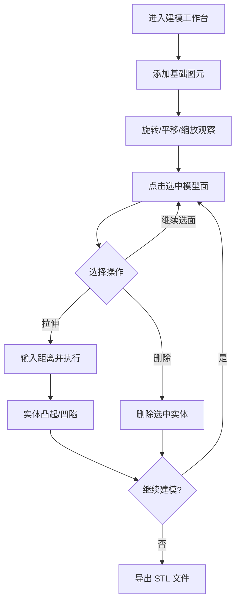

# 产品需求文档（PRD）— 轻量 Web 3D 建模工具

## 1. 产品概述
一款基于浏览器的轻量级 3D 实体建模工具，类似 Fusion 360 的核心建模交互：用户可创建基础图元、点选模型的「面」、在面上做拉伸与删除，并将成果导出为可 3D 打印的 STL 格式。
- 解决痛点：无需安装重型 CAD 软件，在浏览器中即可完成快速原型建模并直接用于切片打印。
- 目标用户：创客、3D 打印爱好者、产品设计师、需要快速原型验证的用户。

## 2. 核心功能

### 2.1 功能模块
1. **图元创建**：添加立方体、圆柱、球体、圆锥等基础实体作为建模起点。
2. **面选择**：鼠标点击/悬停选中模型上的某个平面，高亮显示。
3. **拉伸（Extrude）**：选中面后沿其法线方向拉伸，支持正向（外凸/并集）与负向（内凹/差集）。
4. **删除（Delete）**：删除选中面所在的整个实体。
5. **视图操作**：旋转（Orbit）、平移（Pan）、缩放（Zoom），及网格参考系。
6. **导出**：将当前模型导出为 STL / OBJ 文件，供 3D 打印切片软件使用。

### 2.2 页面详情
| 页面名称 | 模块名称 | 功能描述 |
|---------|---------|---------|
| 建模工作台 | 顶部工具栏 | 图元添加按钮、拉伸/删除操作、撤销、导出 |
| 建模工作台 | 3D 视口 | 渲染实体模型、网格与坐标轴，支持旋转/平移/缩放 |
| 建模工作台 | 操作面板 | 选中面后的拉伸距离输入、操作按钮（拉伸/删除/取消） |
| 建模工作台 | 状态栏 | 显示当前模式、实体数量、操作提示 |

## 3. 核心流程

用户进入建模工作台 → 添加基础图元 → 旋转视角观察 → 点击选中某个面 → 输入拉伸距离并执行拉伸（实体随之凸起或凹陷）→ 或对选中面执行删除（移除该实体）→ 重复上述步骤完成建模 → 导出 STL 文件用于 3D 打印。

## 4. 用户界面设计

### 4.1 设计风格
- 主题：深色工业风，贴合专业 CAD 工具气质；主背景深灰蓝，视口纯黑灰。
- 主色：深石板灰 `#1a1d24`；强调色：霓虹青 `#35d0c0` 与琥珀橙 `#ff8a3d`（用于选中高亮）。
- 字体：标题用几何无衬线（如 `Sora`/`Space Grotesk` 类），正文用 `IBM Plex Sans` 类，等宽数字用于尺寸输入。
- 按钮：紧凑圆角，选中态用强调色描边/填充，带 hover 微交互。
- 布局：左侧窄工具栏 + 中央 3D 视口 + 右侧属性/操作面板，顶部为命令栏。
- 图标：线性图标（lucide），统一描边粗细。

### 4.2 页面设计概览
| 页面名称 | 模块名称 | UI 元素 |
|---------|---------|--------|
| 建模工作台 | 顶部命令栏 | 左侧 Logo、中部图元图标按钮、右侧撤销/导出按钮，深色背景 |
| 建模工作台 | 3D 视口 | 全幅画布，网格地面、坐标轴、选中面高亮为琥珀橙 |
| 建模工作台 | 操作面板 | 选中面信息、拉伸距离输入框、拉伸/删除/取消按钮 |

### 4.3 响应式
- 桌面优先，适配 1280px+ 视口。
- 小屏下工具栏折叠为图标，操作面板悬浮于底部。

### 4.4 3D 场景指引
- 环境：柔和渐变背景（深灰到黑），无 HDRI，使用方向光 + 环境光保证形体可读。
- 光照：主方向光 + 填充环境光，材质为标准材质（roughness 略高）。
- 相机：透视相机，OrbitControls 默认 45° 视角，平滑阻尼。
- 构图：模型居中，网格地面提供空间参考。
- 交互：hover 面轻微高亮，选中面强高亮；拉伸后模型即时更新。
- 后处理：可选轻微抗锯齿（MSAA）。
