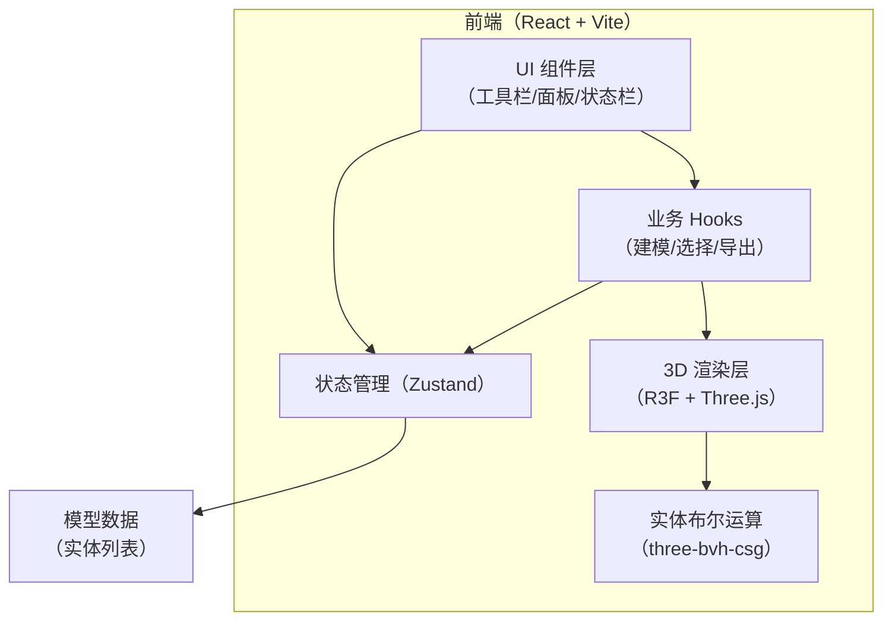

# 技术架构文档 — 轻量 Web 3D 建模工具

## 1. 架构设计

## 2. 技术说明
- 前端框架：React 18 + TypeScript
- 样式：tailwindcss 3
- 3D 渲染：three + @react-three/fiber + @react-three/drei
- 布尔运算：three-bvh-csg（用于拉伸的并集/差集）
- 状态管理：zustand
- 初始化工具：vite-init（react-ts 模板）
- 后端：无（纯前端单页应用）
- 包管理器：npm

## 3. 路由定义
| 路由 | 用途 |
|------|------|
| / | 建模工作台（单页应用，唯一路由） |

## 4. 核心数据模型
| 实体 | 说明 |
|------|------|
| `Solid` | 一个实体：`{ id, name, geometry }`（three.js BufferGeometry + Material） |
| `Selection` | 当前选中：`{ solidId, faceIndex, normal, polygon }` |
| `ToolState` | 当前工具模式：`select / extrude / delete` |

## 5. 关键实现要点
- **面选择**：射线检测命中三角面，按法线方向聚合同平面的相邻三角形，提取面边界多边形。
- **拉伸**：由选中面的边界多边形沿法线构建拉伸棱柱（ExtrudeGeometry），通过 `three-bvh-csg` 做并集（外凸）或差集（内凹），替换原实体几何。
- **删除**：移除选中面所属的整个实体。
- **导出**：合并所有实体几何，使用 `three-stdlib` 的 STLExporter 生成 STL 文件并下载。
